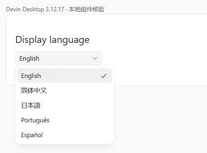

# Devin Desktop 简体中文语言包

为 Windows 版 Devin Desktop **3.12.17** 新增可选择的「简体中文」。在个人偏好设置中选择「English」或「简体中文」，当前窗口和同一配置下的其他窗口会立即切换。会话页面、编辑器标签、未保存的修改和撤销历史都留在原处。



## 安装

1. 安装 Windows 版 Devin Desktop 3.12.17 和 Python 3.10 或更高版本。当前适配的编辑器内核为 1.141.2。
2. 下载 [发布包](https://github.com/okht/devin-desktop-zh-cn/releases/latest)，解压，保存当前工作并完全退出 Devin。
3. 在解压目录打开终端，运行以下命令。首次安装时，工具会调用 Devin 自带的扩展安装器获取微软简体中文扩展 1.131.0。

   ```powershell
   .\Devin-ZH.cmd apply
   ```

4. 打开 Devin，在「Settings → Preferences → Appearance → Display language」选择「简体中文」。切回英文时，在「设置 → 偏好设置 → 外观 → 界面语言」选择「English」。两种语言即时生效，也会保留到下次启动。命令面板里的「配置显示语言」同样支持中英文热切换。

从 `v3.12.17-zh.1` 升级时，直接用新版发布包运行同一条安装命令。安装或升级后首次打开 Devin 会加载新版代码，之后更改语言无需重启或刷新窗口。

也可以直接运行 `py -3 devin_zh.py apply`。自定义安装目录可附加 `--app "D:\Apps\Devin\resources\app"`。脚本会核对构建和原文件的 SHA-256，遇到其他版本或未经识别的修改会显示具体文件。

## 检查与恢复

```powershell
.\Devin-ZH.cmd status
.\Devin-ZH.cmd restore
```

恢复前请保存工作并退出 Devin。恢复命令会从本机备份还原应用文件和微软扩展的原版词典。微软简体中文扩展保留在扩展列表里，可单独卸载。安装和恢复均保留当前界面语言偏好。

## 翻译范围

| 界面 | 示例 |
| --- | --- |
| 会话和工具活动 | 「已运行」「已思考 4 秒」「已发起代码扫描」「正在执行操作」 |
| Git 提交和代码审查 | 区分提交作者、提交者与共同署名顺序，PR 统一使用「拉取请求」 |
| 本地设置和代码补全 | 自动继续、代码检查、行内提示、按 Tab 导入与跳转 |
| DeepWiki 和会话菜单 | 生成投入程度、更新频率、语言名称、定时运行与更改父会话 |

会话主词典有 23,552 个条目，代码审查词典有 1,341 个条目。编辑器生成 27,543 条界面消息。命令参数、文件路径和用户的会话内容照原样显示。DeepWiki 的「生成语言」用于配置知识库内容，原版始终勾选英语。

热切换覆盖 Devin 的会话与设置界面、内置聊天组件、窗口菜单、编辑器侧栏与状态栏。操作系统的文件选择框和第三方扩展自己绘制的界面使用各自的语言设置。

在两个真实的 Windows 版 Devin 窗口里，已验证双向切换、同步更新、编辑选区和撤销记录。偏好设置里的实际下拉控件另用隔离数据验证，切换时同一 React 树中的草稿和输入框保持原位。发布包管理 333 个安装目标，并保留原版文件供恢复。

## 仓库内容

- `locales/` 保存中文词典、编辑器补充词条和内置扩展的显示字段。360 个沿用原文的会话词条在安装时从用户自己的 Devin 中读取。
- `patches/` 保存本构建的界面修改。每行记录原文件字符位置、替换长度和新增内容。嵌入词典的位置引用同一份中文词典。
- `manifest.json` 记录支持的构建，以及安装前后各文件的 SHA-256。原版程序、个人启动配置和聊天记录均不随发布包分发。
- `src/live.py`、`src/live-language.js` 和 `src/react-language.js` 连接原生语言服务与界面更新。两份原生消息表由安装器在本机生成。编辑器的文字绑定使用带消息编号的控件，文件内容和终端输出保持原样。

维护译文时，可在原版安装和微软语言包上运行以下检查。它在内存中重建所有目标并核对哈希。修改词条后可附加 `--update-hashes` 更新仓库里的发布清单。

```powershell
py -3 tools/check_build.py --app "D:\Apps\Devin\resources\app" --extensions "$env:USERPROFILE\.devin\extensions"
```

如需在已安装本包的副本上检查两个语言入口，可用 Node.js 24 运行 `node tests/live-switch.cjs "D:\Apps\Devin\resources\app"`。此检查使用内存中的偏好设置。

会话及界面译文参考了两个社区项目，编辑器基础词典使用微软简体中文扩展。各来源与许可见 [第三方声明](THIRD_PARTY_NOTICES.md)。
